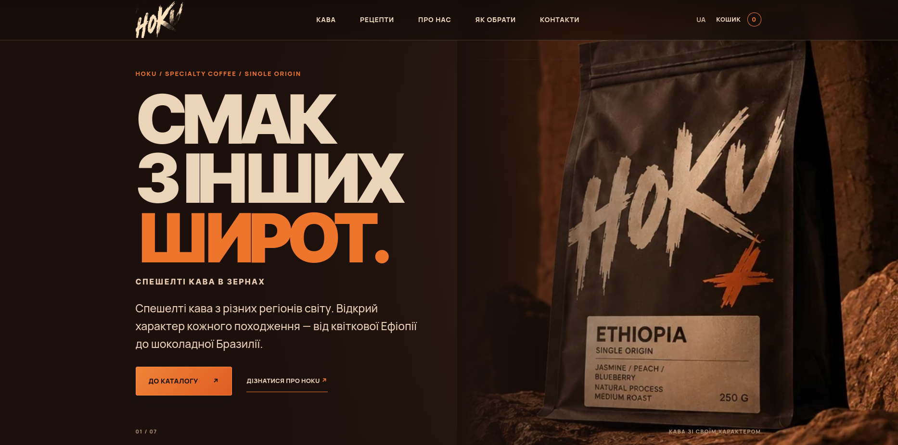

# HOKU — Specialty Coffee

**HOKU** — навчальний комерційний лендінг бренду спешелті кави, створений на основі безкоштовного HTML + Tailwind шаблону [Roast від Freeframe](https://freeframe.dev/templates/roast).

Проєкт передбачає редизайн шаблону, оновлення контенту, розробку каталогу кави та реалізацію демонстраційного сценарію замовлення.

### Демонстраційний варіант перегляду вмісту



> [!WARNING] Цей веб-сайт є навчальним проєктом, створеним виключно з освітньою метою в межах навчального курсу. Сайт не здійснює комерційної діяльності, не надає платних послуг і не призначений для отримання прибутку.

## Основні можливості

- Каталог спешелті кави із семи країн: Бразилія, Колумбія, Коста-Рика, Ефіопія, Гондурас, Кенія та Руанда.
- Демонстраційний кошик із використанням `localStorage`.
- Тестове оформлення замовлення без реальних платежів.
- Розділ із чотирма рецептами: AeroPress, V60, French Press і Cold Brew.
- Адаптивна верстка для мобільних пристроїв.
- Інтерактивні кнопки, модальні вікна та клавіатурна навігація.

## Дизайн та стилізація

Використано власну колірну палітру:

- Темний шоколад — `#1b100c`
- Молочно-бежевий — `#ead5b9`
- Помаранчевий — `#ed762c`

Оновлено типографіку, відступи, фони, зображення, стилі кнопок і навігацію. Додано градієнтні заливки, ефекти `:hover`, `:active` та анімацію `transform: translateY(-3px)`.

## SEO та оптимізація

Підготовлено метатеги `title`, `description` та заголовок `h1` на основі тематичного семантичного ядра.

Зображення оптимізовано у форматі WebP, для графічних елементів передбачено альтернативні описи `alt`.

## Аналітика

Реалізовано систему користувацьких подій через `hoku:analytics` для моделювання воронки взаємодії:

- `view_item_list`
- `view_item`
- `add_to_cart`
- `view_cart`
- `begin_checkout`
- `generate_lead`
- `demo_order_complete`

Події підготовлені для інтеграції з Google Analytics 4. Реальні покупки не здійснюються, подія `purchase` не використовується.

## Технології

- HTML5
- CSS3
- JavaScript
- Tailwind CSS (основа оригінального шаблону)
- LocalStorage
- GitHub Pages

## Структура проєкту

```text
HOKU/
├── assets/
│   ├── demos/
│   ├── icons/
│   └── img/
├── assets/css/
│   ├── style.css
│   └── hoku.css
├── assets/js/
│   ├── hoku.js
│   └── recipes.js
├── index.html
├── LICENSE.txt
└── README.md
```

## Запуск

1. Завантажити або клонувати репозиторій.
2. Відкрити `index.html` у браузері.
3. Переглянути каталог, рецепти та демонстраційний кошик.

Сайт не потребує сервера або бази даних для локального перегляду.

## Походження та авторство

Оригінальний шаблон: [Roast — Freeframe](https://freeframe.dev/templates/roast).

Ліцензія оригіналу — MIT. Копію ліцензії збережено у `LICENSE.txt`.

**Авторка:** Burenko Polina

**HOKU — Specialty Coffee | 2026**